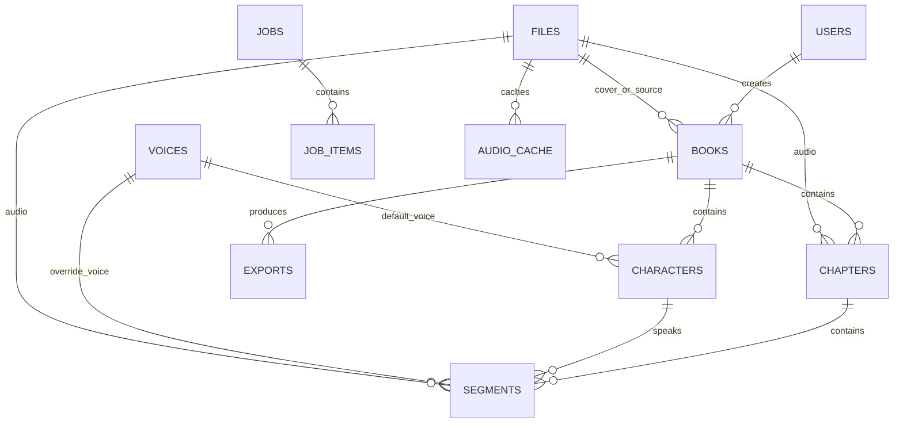

# 03 数据库设计

> 文档版本：v0.2（评审稿）
> 数据库：MySQL 8.0+，InnoDB，`utf8mb4` / `utf8mb4_0900_ai_ci`
> 数据库初始化：代码内嵌 DDL（`src/common/schema.rs`），启动时执行并记录 `schema_migrations`
> 时间：全部 `DATETIME(3)`，应用层写入 UTC；API 输出 ISO-8601 UTC
> **本版变更：建表 SQL 改为内嵌 Rust 代码；`speaker_confidence` 使用 FLOAT。**

## 1. 设计约定

| 项 | 约定 |
| --- | --- |
| 主键 | `BIGINT UNSIGNED AUTO_INCREMENT` |
| 外键 | 物理外键 + `ON DELETE RESTRICT / SET NULL / CASCADE`（见各表） |
| 状态字段 | `VARCHAR(24)` + 应用枚举 + MySQL 8 `CHECK` 约束 |
| 金额 | 无（MVP 不计费） |
| 软删除 | 仅 `books.deleted_at`；其余物理删除并受外键保护 |
| 索引命名 | `idx_{表}_{列}` / `uk_{表}_{列}` |
| 字符集 | 所有表和列继承库级 `utf8mb4` |
| 大文本 | 章节正文 `MEDIUMTEXT`（最大 16MB），段落 `TEXT` |

## 2. ER 关系



关系说明：

- 一个 `book` 多个 `chapter`；一个 `chapter` 多个 `segment`。
- `segment.speaker_id` 指向 `characters`；对白未识别时为空。
- 音色生效优先级：`segment.voice_id` > `character.default_voice_id` > `chapter.narrator_voice_id` > `book.default_narrator_voice_id` > 系统默认。
- `files` 是对象存储的元数据注册表，不直接存二进制。

## 3. 表结构

### 3.1 `users` 管理员账号

| 字段 | 类型 | 允许空 | 默认 | 说明 |
| --- | --- | --- | --- | --- |
| `id` | BIGINT UNSIGNED | 否 | 自增 | 主键 |
| `username` | VARCHAR(64) | 否 | — | 唯一 |
| `password_hash` | VARCHAR(255) | 否 | — | Argon2id 哈希 |
| `display_name` | VARCHAR(64) | 是 | NULL | 显示名 |
| `role` | VARCHAR(16) | 否 | `admin` | `admin`（MVP 仅此角色） |
| `last_login_at` | DATETIME(3) | 是 | NULL | 最近登录 |
| `created_at` | DATETIME(3) | 否 | 当前时间 | — |
| `updated_at` | DATETIME(3) | 否 | 当前时间 | 应用更新 |

索引：`uk_users_username(username)`。

### 3.2 `files` 对象存储文件注册表

| 字段 | 类型 | 允许空 | 默认 | 说明 |
| --- | --- | --- | --- | --- |
| `id` | BIGINT UNSIGNED | 否 | 自增 | 主键 |
| `bucket` | VARCHAR(64) | 否 | — | 桶名 |
| `object_key` | VARCHAR(512) | 否 | — | 对象 Key，不做用户输入拼接 |
| `file_name` | VARCHAR(255) | 否 | — | 原始/展示文件名 |
| `mime` | VARCHAR(128) | 否 | — | MIME |
| `size_bytes` | BIGINT UNSIGNED | 否 | — | 字节数 |
| `sha256` | CHAR(64) | 否 | — | 内容哈希 |
| `kind` | VARCHAR(24) | 否 | — | `source/cover/segment_audio/chapter_audio/export_zip/voice_sample` |
| `duration_ms` | INT UNSIGNED | 是 | NULL | 音频时长；非音频为空 |
| `created_at` | DATETIME(3) | 否 | 当前时间 | — |

索引：

- `uk_files_bucket_object(bucket, object_key)`
- `idx_files_sha256(sha256)`
- `idx_files_kind(kind)`

### 3.3 `voices` 音色目录

| 字段 | 类型 | 允许空 | 默认 | 说明 |
| --- | --- | --- | --- | --- |
| `id` | BIGINT UNSIGNED | 否 | 自增 | 主键 |
| `provider` | VARCHAR(32) | 否 | — | `openai/minimax/stepfun` |
| `provider_voice_id` | VARCHAR(128) | 否 | — | 引擎侧音色 ID |
| `display_name` | VARCHAR(128) | 否 | — | 展示名 |
| `locale` | VARCHAR(16) | 否 | — | 如 `zh-CN` |
| `gender` | VARCHAR(8) | 否 | `unknown` | `male/female/unknown` |
| `styles` | JSON | 是 | NULL | 支持风格数组（如 `["cheerful"]`） |
| `sample_file_id` | BIGINT UNSIGNED | 是 | NULL | 试听样例，FK `files.id` |
| `is_custom` | TINYINT(1) | 否 | 0 | 是否自定义/克隆音色（MVP 均 0） |
| `enabled` | TINYINT(1) | 否 | 1 | 是否可用 |
| `extra` | JSON | 是 | NULL | 引擎扩展信息 |
| `created_at` | DATETIME(3) | 否 | 当前时间 | — |
| `updated_at` | DATETIME(3) | 否 | 当前时间 | — |

索引：

- `uk_voices_provider_voice(provider, provider_voice_id)`
- `idx_voices_locale_gender(locale, gender)`

外键：`sample_file_id → files.id ON DELETE SET NULL`。

### 3.4 `books` 书籍

| 字段 | 类型 | 允许空 | 默认 | 说明 |
| --- | --- | --- | --- | --- |
| `id` | BIGINT UNSIGNED | 否 | 自增 | 主键 |
| `title` | VARCHAR(255) | 否 | — | 书名 |
| `author` | VARCHAR(128) | 是 | NULL | 作者 |
| `description` | TEXT | 是 | NULL | 简介 |
| `language` | VARCHAR(16) | 否 | `zh-CN` | 语言 |
| `cover_file_id` | BIGINT UNSIGNED | 是 | NULL | 封面，FK `files.id` |
| `source_file_id` | BIGINT UNSIGNED | 是 | NULL | 导入源文件，FK `files.id` |
| `default_narrator_voice_id` | BIGINT UNSIGNED | 是 | NULL | 旁白音色，FK `voices.id` |
| `settings` | JSON | 否 | 见下 | 停顿/响度/输出/TTS 默认值 |
| `status` | VARCHAR(24) | 否 | `draft` | 书籍状态 |
| `total_chapters` | INT UNSIGNED | 否 | 0 | 章节数 |
| `total_segments` | INT UNSIGNED | 否 | 0 | 段落数 |
| `total_duration_ms` | BIGINT UNSIGNED | 否 | 0 | 已拼接章节总时长 |
| `created_by` | BIGINT UNSIGNED | 是 | NULL | 创建人，FK `users.id` |
| `error_message` | TEXT | 是 | NULL | 导入失败摘要 |
| `created_at` | DATETIME(3) | 否 | 当前时间 | — |
| `updated_at` | DATETIME(3) | 否 | 当前时间 | — |
| `deleted_at` | DATETIME(3) | 是 | NULL | 软删除 |

`settings` JSON 结构：

```json
{
  "pause_ms": { "narration": 350, "dialogue": 250, "chapter_end": 1200 },
  "loudness": { "i": -16.0, "tp": -1.5, "lra": 11.0 },
  "output": { "format": "mp3", "sample_rate": 44100, "channels": 1, "bitrate_kbps": 128 },
  "tts": { "provider": "openai", "max_attempts": 3 }
}
```

索引：

- `idx_books_status(status)`
- `idx_books_created_at(created_at)`
- `idx_books_deleted_at(deleted_at)`

外键：`cover_file_id/source_file_id → files.id ON DELETE SET NULL`；`default_narrator_voice_id → voices.id ON DELETE SET NULL`；`created_by → users.id ON DELETE SET NULL`。

### 3.5 `chapters` 章节

| 字段 | 类型 | 允许空 | 默认 | 说明 |
| --- | --- | --- | --- | --- |
| `id` | BIGINT UNSIGNED | 否 | 自增 | 主键 |
| `book_id` | BIGINT UNSIGNED | 否 | — | FK `books.id`，级联删除 |
| `idx` | INT UNSIGNED | 否 | — | 章节序号，从 1 开始 |
| `title` | VARCHAR(255) | 否 | — | 章节标题 |
| `raw_text` | MEDIUMTEXT | 否 | — | 章节正文（不含标题） |
| `char_count` | INT UNSIGNED | 否 | 0 | 正文字数 |
| `status` | VARCHAR(24) | 否 | `pending` | 章节状态 |
| `narrator_voice_id` | BIGINT UNSIGNED | 是 | NULL | 章节级旁白覆盖 |
| `audio_file_id` | BIGINT UNSIGNED | 是 | NULL | 拼接后音频，FK `files.id` |
| `audio_duration_ms` | INT UNSIGNED | 是 | NULL | 章节音频时长 |
| `audio_rev` | INT UNSIGNED | 否 | 1 | 音频版本号，重新拼接递增 |
| `tts_done_segments` | INT UNSIGNED | 否 | 0 | 已合成段落数（冗余统计） |
| `error_message` | VARCHAR(1000) | 是 | NULL | 最近失败原因 |
| `created_at` | DATETIME(3) | 否 | 当前时间 | — |
| `updated_at` | DATETIME(3) | 否 | 当前时间 | — |

索引：

- `uk_chapters_book_idx(book_id, idx)`
- `idx_chapters_book_status(book_id, status)`

外键：`book_id → books.id ON DELETE CASCADE`；`narrator_voice_id → voices.id ON DELETE SET NULL`；`audio_file_id → files.id ON DELETE SET NULL`。

### 3.6 `characters` 角色

| 字段 | 类型 | 允许空 | 默认 | 说明 |
| --- | --- | --- | --- | --- |
| `id` | BIGINT UNSIGNED | 否 | 自增 | 主键 |
| `book_id` | BIGINT UNSIGNED | 否 | — | FK `books.id`，级联删除 |
| `name` | VARCHAR(64) | 否 | — | 角色名 |
| `aliases` | JSON | 否 | `[]` | 别名数组 |
| `gender` | VARCHAR(8) | 否 | `unknown` | `male/female/unknown` |
| `age_group` | VARCHAR(16) | 否 | `unknown` | `child/teen/adult/elder/unknown` |
| `description` | TEXT | 是 | NULL | 角色描述 |
| `default_voice_id` | BIGINT UNSIGNED | 是 | NULL | 默认音色，FK `voices.id` |
| `color` | VARCHAR(16) | 是 | NULL | UI 标签色 |
| `source` | VARCHAR(16) | 否 | `manual` | `manual/rule/llm` |
| `created_at` | DATETIME(3) | 否 | 当前时间 | — |
| `updated_at` | DATETIME(3) | 否 | 当前时间 | — |

索引：

- `uk_characters_book_name(book_id, name)`
- `idx_characters_book(book_id)`

外键：`book_id → books.id ON DELETE CASCADE`；`default_voice_id → voices.id ON DELETE SET NULL`。

### 3.7 `segments` 段落（合成最小单元）

| 字段 | 类型 | 允许空 | 默认 | 说明 |
| --- | --- | --- | --- | --- |
| `id` | BIGINT UNSIGNED | 否 | 自增 | 主键 |
| `chapter_id` | BIGINT UNSIGNED | 否 | — | FK `chapters.id`，级联删除 |
| `idx` | INT UNSIGNED | 否 | — | 段内序号，从 1 开始 |
| `text` | TEXT | 否 | — | 供 TTS 的纯文本（不含引号标记则保留原文） |
| `char_count` | INT UNSIGNED | 否 | 0 | 字数 |
| `seg_type` | VARCHAR(16) | 否 | `narration` | `narration/dialogue` |
| `speaker_id` | BIGINT UNSIGNED | 是 | NULL | 说话角色，FK `characters.id` |
| `speaker_confidence` | FLOAT | 是 | NULL | 0.000–1.000 |
| `voice_id` | BIGINT UNSIGNED | 是 | NULL | 段落级音色覆盖 |
| `emotion` | VARCHAR(24) | 否 | `neutral` | 情感/风格 |
| `rate_percent` | SMALLINT | 否 | 0 | 语速，-50..+100 |
| `pitch_hz` | SMALLINT | 否 | 0 | 音调，-50..+50 |
| `volume_percent` | SMALLINT | 否 | 0 | 音量，-50..+50 |
| `status` | VARCHAR(16) | 否 | `pending` | `pending/synthesizing/done/failed/skipped` |
| `audio_file_id` | BIGINT UNSIGNED | 是 | NULL | 段落音频，FK `files.id` |
| `audio_duration_ms` | INT UNSIGNED | 是 | NULL | 音频时长 |
| `cache_key` | CHAR(64) | 是 | NULL | 最近一次合成缓存键 |
| `error_message` | VARCHAR(500) | 是 | NULL | 失败原因 |
| `attempts` | TINYINT UNSIGNED | 否 | 0 | 已尝试次数 |
| `created_at` | DATETIME(3) | 否 | 当前时间 | — |
| `updated_at` | DATETIME(3) | 否 | 当前时间 | — |

索引：

- `uk_segments_chapter_idx(chapter_id, idx)`
- `idx_segments_chapter_status(chapter_id, status)`
- `idx_segments_cache_key(cache_key)`
- `idx_segments_speaker(speaker_id)`

外键：`chapter_id → chapters.id ON DELETE CASCADE`；`speaker_id → characters.id ON DELETE SET NULL`；`voice_id → voices.id ON DELETE SET NULL`；`audio_file_id → files.id ON DELETE SET NULL`。

### 3.8 `audio_cache` 合成音频缓存

| 字段 | 类型 | 允许空 | 默认 | 说明 |
| --- | --- | --- | --- | --- |
| `cache_key` | CHAR(64) | 否 | — | 主键，SHA-256 十六进制 |
| `provider` | VARCHAR(32) | 否 | — | 引擎 |
| `provider_voice_id` | VARCHAR(128) | 否 | — | 引擎音色 ID |
| `text_sha256` | CHAR(64) | 否 | — | 文本哈希 |
| `params_json` | JSON | 否 | — | 语速/音调/音量/情绪/格式 |
| `file_id` | BIGINT UNSIGNED | 否 | — | FK `files.id` |
| `duration_ms` | INT UNSIGNED | 否 | — | 音频时长 |
| `hit_count` | INT UNSIGNED | 否 | 0 | 命中次数 |
| `created_at` | DATETIME(3) | 否 | 当前时间 | — |
| `last_hit_at` | DATETIME(3) | 是 | NULL | 最近命中 |

索引：

- 主键 `cache_key`
- `idx_audio_cache_voice(provider, provider_voice_id)`
- `idx_audio_cache_file(file_id)`

外键：`file_id → files.id ON DELETE CASCADE`。

### 3.9 `jobs` 任务

| 字段 | 类型 | 允许空 | 默认 | 说明 |
| --- | --- | --- | --- | --- |
| `id` | BIGINT UNSIGNED | 否 | 自增 | 主键 |
| `job_type` | VARCHAR(32) | 否 | — | `import_parse/character_detect/chapter_tts/chapter_merge/book_export` |
| `status` | VARCHAR(16) | 否 | `queued` | `queued/running/succeeded/partial/failed/canceled` |
| `priority` | TINYINT UNSIGNED | 否 | 5 | 数值越大越优先 |
| `book_id` | BIGINT UNSIGNED | 是 | NULL | 便于筛选，FK `books.id` |
| `chapter_id` | BIGINT UNSIGNED | 是 | NULL | 便于筛选，FK `chapters.id` |
| `created_by` | BIGINT UNSIGNED | 是 | NULL | FK `users.id` |
| `payload` | JSON | 否 | — | 任务参数快照 |
| `result` | JSON | 是 | NULL | 结果摘要（输出文件、统计） |
| `total_items` | INT UNSIGNED | 否 | 0 | 子项总数 |
| `done_items` | INT UNSIGNED | 否 | 0 | 成功子项数 |
| `failed_items` | INT UNSIGNED | 否 | 0 | 失败子项数 |
| `progress` | TINYINT UNSIGNED | 否 | 0 | 0–100 |
| `current_step` | VARCHAR(128) | 是 | NULL | 当前步骤描述 |
| `error_message` | TEXT | 是 | NULL | 失败摘要 |
| `attempts` | TINYINT UNSIGNED | 否 | 0 | 任务级尝试次数 |
| `max_attempts` | TINYINT UNSIGNED | 否 | 3 | 任务级最大尝试 |
| `cancel_requested` | TINYINT(1) | 否 | 0 | 取消标记 |
| `worker_id` | VARCHAR(64) | 是 | NULL | 认领者 |
| `scheduled_at` | DATETIME(3) | 否 | 当前时间 | 可执行时间（退避用） |
| `heartbeat_at` | DATETIME(3) | 是 | NULL | 心跳时间 |
| `started_at` | DATETIME(3) | 是 | NULL | 开始时间 |
| `finished_at` | DATETIME(3) | 是 | NULL | 结束时间 |
| `created_at` | DATETIME(3) | 否 | 当前时间 | — |
| `updated_at` | DATETIME(3) | 否 | 当前时间 | — |

索引：

- `idx_jobs_claim(status, scheduled_at, priority, created_at)`
- `idx_jobs_book_type_status(book_id, job_type, status)`
- `idx_jobs_worker_status(worker_id, status)`

外键：`book_id → books.id ON DELETE SET NULL`；`chapter_id → chapters.id ON DELETE SET NULL`；`created_by → users.id ON DELETE SET NULL`。

认领 SQL（Worker）：

```sql
START TRANSACTION;
SELECT id FROM jobs
 WHERE status = 'queued'
   AND scheduled_at <= UTC_TIMESTAMP(3)
 ORDER BY priority DESC, created_at ASC
 LIMIT 1
 FOR UPDATE SKIP LOCKED;

UPDATE jobs
   SET status = 'running', worker_id = ?, started_at = UTC_TIMESTAMP(3),
       heartbeat_at = UTC_TIMESTAMP(3), attempts = attempts + 1, updated_at = UTC_TIMESTAMP(3)
 WHERE id = ? AND status = 'queued';
COMMIT;
```

### 3.10 `job_items` 任务子项

| 字段 | 类型 | 允许空 | 默认 | 说明 |
| --- | --- | --- | --- | --- |
| `id` | BIGINT UNSIGNED | 否 | 自增 | 主键 |
| `job_id` | BIGINT UNSIGNED | 否 | — | FK `jobs.id`，级联删除 |
| `item_type` | VARCHAR(24) | 否 | — | `segment/chapter` |
| `item_id` | BIGINT UNSIGNED | 否 | — | 对应实体 ID |
| `status` | VARCHAR(16) | 否 | `pending` | `pending/running/done/failed/skipped` |
| `attempts` | TINYINT UNSIGNED | 否 | 0 | 子项尝试次数 |
| `error_message` | VARCHAR(500) | 是 | NULL | 失败原因 |
| `updated_at` | DATETIME(3) | 否 | 当前时间 | — |
| `created_at` | DATETIME(3) | 否 | 当前时间 | — |

索引：

- `uk_job_items_job_item(job_id, item_type, item_id)`
- `idx_job_items_job_status(job_id, status)`

外键：`job_id → jobs.id ON DELETE CASCADE`。

### 3.11 `exports` 导出记录

| 字段 | 类型 | 允许空 | 默认 | 说明 |
| --- | --- | --- | --- | --- |
| `id` | BIGINT UNSIGNED | 否 | 自增 | 主键 |
| `book_id` | BIGINT UNSIGNED | 否 | — | FK `books.id`，级联删除 |
| `export_type` | VARCHAR(24) | 否 | `book_zip` | MVP 仅此类型 |
| `format` | VARCHAR(8) | 否 | `zip` | 输出格式 |
| `status` | VARCHAR(16) | 否 | `queued` | `queued/running/succeeded/failed` |
| `options` | JSON | 否 | — | 是否含封面、章节范围等 |
| `total_chapters` | INT UNSIGNED | 否 | 0 | 应包含章节数 |
| `included_chapters` | INT UNSIGNED | 否 | 0 | 实际包含章节数 |
| `file_id` | BIGINT UNSIGNED | 是 | NULL | ZIP 文件，FK `files.id` |
| `error_message` | TEXT | 是 | NULL | 失败原因 |
| `created_at` | DATETIME(3) | 否 | 当前时间 | — |
| `finished_at` | DATETIME(3) | 是 | NULL | 完成时间 |

索引：

- `idx_exports_book_created(book_id, created_at)`
- `idx_exports_status(status)`

外键：`book_id → books.id ON DELETE CASCADE`；`file_id → files.id ON DELETE SET NULL`。

## 4. 状态枚举与流转

### 4.1 书籍状态

| 状态 | 含义 | 允许流转 |
| --- | --- | --- |
| `draft` | 手动创建，未导入 | → `importing` |
| `importing` | 源文件已上传，等待解析 | → `parsing` / `failed` |
| `parsing` | 正在切章 | → `segmenting` / `failed` |
| `segmenting` | 正在切段与角色识别 | → `ready` / `failed` |
| `ready` | 可进行合成 | → `importing`（重新导入） |
| `failed` | 导入失败，可重试 | → `importing` |
| `archived` | 归档，不参与列表默认展示 | → `ready` |

### 4.2 章节状态

| 状态 | 含义 | 允许流转 |
| --- | --- | --- |
| `pending` | 已建章，未切段 | → `segmenting` |
| `segmenting` | 切段中 | → `segmented` / `failed` |
| `segmented` | 已切段，可合成 | → `tts_partial` / `tts_done` / `segmenting` |
| `tts_partial` | 部分段落完成合成 | → `tts_done` / `tts_partial` |
| `tts_done` | 全部段落合成完成 | → `merged` / `tts_partial`（重合成） |
| `merged` | 已生成章节音频 | → `tts_partial`（音频失效） |
| `failed` | 切段/切章失败 | → `segmenting` / `segmented` |

### 4.3 段落状态

`pending → synthesizing → done | failed`；`pending/synthesizing → skipped`（取消或跳过）。
重新合成：`done/failed → synthesizing`。
文本或参数变更：`done/failed → pending`，并清空 `audio_file_id/cache_key`。

### 4.4 任务状态

| 状态 | 含义 | 允许流转 |
| --- | --- | --- |
| `queued` | 待认领 | → `running` / `canceled` |
| `running` | 执行中 | → `succeeded` / `partial` / `failed` / `canceled` |
| `partial` | 完成但有失败子项 | 终态；重试时创建新任务（复制原任务，仅失败子项） |
| `failed` | 执行失败 | 终态；重试时创建新任务 |
| `canceled` | 已取消 | 终态（可复制为新任务） |
| `succeeded` | 全部成功 | 终态 |

## 5. 建表与版本管理

**所有建表 SQL 内嵌在 Rust 代码中，不再维护 `.sql` 文件。**

实现位置：`backend/src/common/schema.rs`

```text
common::db::migrate()
  └── schema::apply(pool)
        ├── 1. CREATE TABLE IF NOT EXISTS schema_migrations
        ├── 2. 查询已执行的 version
        ├── 3. 对未执行的版本调用 sqlx::raw_sql(sql).execute(pool)
        └── 4. 写入 schema_migrations(version)
```

当前版本：

| 版本 | 内容 |
| --- | --- |
| `0001_initial` | 11 张业务表 + 外键/索引 |

建表顺序（满足外键依赖）：

```text
users → files → voices → books → chapters → characters → segments
→ audio_cache → jobs → job_items → exports
```

规则：

1. 新变更新增一个版本常量，不修改已发布版本。
2. DDL 使用 `CREATE TABLE IF NOT EXISTS`，保证失败重试可重复执行。
3. 所有外键列显式建索引。
4. 应用启动时自动执行；无需单独运行迁移命令。

## 6. 初始化与种子数据

| 数据 | 方式 |
| --- | --- |
| 管理员 | 启动时若 `users` 为空，用 `ADMIN_USERNAME/ADMIN_PASSWORD` 创建（Argon2id），之后不再覆盖 |
| 音色 | 不内置音色；用户通过 `POST /api/v1/voices` 手动登记 provider + provider_voice_id |
| 默认书籍设置 | 创建书籍时使用 `BookSettings::default()` 写入 `books.settings` |
| 其他 | 无 |

## 7. 数据一致性与并发

1. **任务认领**：单条 `SELECT ... FOR UPDATE SKIP LOCKED` + 条件更新，避免重复执行。
2. **段落合成**：`UPDATE segments SET status='synthesizing' WHERE id=? AND status IN ('pending','failed')`，受影响行数为 0 则跳过。
3. **缓存写入**：`INSERT ... ON DUPLICATE KEY UPDATE last_hit_at=..., hit_count=hit_count+1`。
4. **章节进度**：段落状态更新后，事务内重算 `tts_done_segments` 与章节状态。
5. **对象与数据库**：先上传对象，再写 `files`，最后更新业务表；失败时尽力删除对象。
6. **批量导入**：按章节分批事务（每章一条 `chapters` + 该章 `segments`），避免单事务过大。

## 8. 容量估算（用于索引与分页设计）

| 数据 | 规模假设 | 说明 |
| --- | --- | --- |
| 单书字数 | 100 万字 | MVP 上限 |
| 单书章节 | 1000 章 | 分页返回 |
| 单章节段落 | 200 段 | 一次合成任务 |
| 单书段落 | 约 2 万段 | 列表必须分页 |
| 单段音频 | 5–60 秒 | 章节拼接时下载到临时目录 |

## 9. 评审关注点

1. 是否同意 `books.settings` 使用 JSON 保存停顿/响度/输出参数（而非单独配置表）。
2. 是否同意 `segments` 冗余 `cache_key/attempts/error_message`，便于重试与排障。
3. 是否同意 `jobs` 与 `job_items` 双表（任务级 + 子项级进度）。
4. 是否同意仅 `books` 做软删除，其他实体物理删除。
