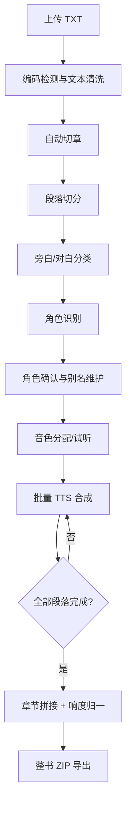

# 05 核心业务流程（分步设计）

> 文档版本：v0.2（评审稿）
> 本文把有声书生产的每个环节拆成可执行步骤，作为后端实现与验收的唯一流程基准。
> **本版变更：无流程变更，仅将代码组织相关表述改为「功能模块」，并做版本对齐。**
> 每个流程都包含：前置条件 → 输入 → 步骤 1..N → 输出 → 异常处理 → 验收点。

## 1. 全流程总览



状态主线：

```text
书籍: draft → importing → parsing → segmenting → ready
章节: pending → segmenting → segmented → tts_partial → tts_done → merged
段落: pending → synthesizing → done / failed
任务: queued → running → succeeded / partial / failed / canceled
```

## 2. 流程 A：书籍导入与解析（`import_parse`）

### 2.1 前置条件

1. 用户已登录。
2. 上传文件为 `.txt`，大小 ≤50MB。
3. 系统可用（MySQL、RustFS 正常）。

### 2.2 输入与输出

| 项 | 内容 |
| --- | --- |
| 输入 | multipart：`file`、`title?`、`author?` |
| 输出 | `202 { book_id, job_id }`；后台完成切章、切段、角色识别 |
| 涉及表 | `files`、`books`、`chapters`、`segments`、`characters`、`jobs`、`job_items` |

### 2.3 API 侧步骤

1. 校验 JWT，取 `user_id`。
2. 校验 `Content-Length` ≤ 50MB，否则 `413/30002`。
3. 校验扩展名必须为 `.txt`，否则 `415/30001`。
4. 读取文件字节，计算 SHA-256。
5. 先创建 `books`（事务提交）：`title` 缺省为文件名去扩展名、`status=draft`、`settings` 使用默认配置、`created_by`，得到 `book_id`。
6. 生成对象 Key：`sources/{book_id}/{uuid}.txt`。
7. 上传源文件到 RustFS。
8. 写 `files` 记录（`kind=source`，含大小与 SHA-256）。
9. 在事务中更新 `books` 并创建任务：
   - `books.status=importing`、`source_file_id`、`error_message=NULL`；
   - `jobs`：`job_type=import_parse`、`status=queued`、`payload={book_id, file_id, options}`、`total_items=0`。
10. 提交事务，返回 `202 {book_id, job_id}`。
11. 失败处理：
    - 上传失败：将书籍置为 `failed` 并返回 `30003`（书籍可由用户重试或删除）；
    - 任务事务失败：尽力删除已上传对象，书籍置为 `failed`，记录 `warn` 日志。

### 2.4 Worker 侧步骤

1. 认领任务（见流程 H），置 `running`，`current_step=读取源文件`。
2. 根据 `payload.file_id` 从 RustFS 下载文件字节；失败则任务失败。
3. **编码检测**：
   1. 若存在 UTF-8 BOM，去 BOM，按 UTF-8 解码；
   2. 否则尝试严格 UTF-8 解码（`std::str::from_utf8`）；
   3. 失败则用 GB18030 解码（覆盖 GBK/GB2312）；
   4. 解码后若替换字符 `�` 占比 > 0.5%，任务失败并提示编码不支持。
4. **文本规范化**：
   1. `\r\n` / `\r` → `\n`；
   2. 去除零宽字符（`\u{200B}`、`\u{FEFF}` 等）；
   3. 去除行尾空白；
   4. 连续 3 个以上空行压缩为 2 个；
   5. 全角空格转半角空格（仅行首缩进处理）。
5. **切章**，按以下优先级：
   1. 主正则：`^\s*(第[零一二三四五六七八九十百千万两0-9]+[章回节卷篇集部])([\s:：、.．-]*)(.{0,40})$`（逐行匹配）；
   2. 特殊标题：`序章|楔子|引子|前言|后记|尾声|番外`（允许带编号）；
   3. 若匹配到的章节数 < 2，使用长度兜底：按段落边界每约 30,000 字切一块，标题为「第 N 部分」；
   4. 第一个章节标题之前的内容若存在，归入「前言」章节。
6. 校验章节数：
   - 0 章 → 失败（空文件或解析失败）；
   - > 2000 章 → 失败并提示拆分文件。
7. 更新 `books.status=parsing`，`current_step=切分章节`。
8. 逐章写入（每章一个事务，避免大事务）：
   1. 计算 `idx`（从 1 连续递增）；
   2. 标题去空白，超长截断到 255 字符；
   3. 正文 = 当前标题行之后到下一个标题行之前的文本，`trim`；
   4. 空正文章节跳过，但 `idx` 已连续编号（后续重排）；
   5. 写 `chapters`，`status=pending`，`char_count=chars().count()`。
9. 每处理 10 章更新一次任务进度（`current_step=切分章节 x/y`）。
10. 更新 `books.status=segmenting`，`current_step=切分段落`。
11. 对每章执行「流程 A-1：切段」：
    1. 按空行拆段落；
    2. 超长段落按句末标点（`。！？!?…`）切分并合并到 ≤`max_chars`（默认 300）；
    3. 对每段做旁白/对白分类与引号拆分（规则见 2.5）；
    4. 去除空段与纯符号段；
    5. 连续同类型且合计 ≤`max_chars` 的碎段合并；
    6. 批量插入 `segments`（`status=pending`）。
12. 每章更新 `chapters.status=segmented`、`books.total_segments`。
13. 执行「流程 C：角色识别」（默认开启，可被 `payload.options.skip_speaker_detect` 关闭）。
14. 汇总：
    1. `books.total_chapters`、`total_segments`；
    2. `books.status=ready`；
    3. `job.status=succeeded`，`progress=100`，`result={chapters, segments, characters}`。
15. 清理临时数据（本流程无临时音频）。

### 2.5 切段与旁白/对白分类规则

1. 段落规范化：`trim`，压缩段内连续空格（保留一个）。
2. 引号对：`“”`、`「」`、`『』`、`""`（英文双引号成对出现时）。
3. 分类：
   1. 整段被一对引号包裹 → `dialogue`，`text` 取引号内文本；
   2. 段内含引号对且引号内字符数占段落 ≥50% → 按引号边界拆成多段：引号内 `dialogue`，引号外 `narration`；
   3. 其余 → `narration`；
   4. 英文单引号不参与分类，避免误判。
4. 引号内文本去除外层引号后再入库（TTS 不朗读引号）。
5. 碎段合并：长度 <4 字符的段，若相邻段同类型且合并后 ≤`max_chars`，合并；否则保留。
6. `char_count = text.chars().count()`（Unicode 字符数，不是字节数）。

### 2.6 异常处理

| 异常 | 处理 |
| --- | --- |
| 文件下载失败 | 任务 `failed`，`error_message=下载源文件失败`；书籍 `failed` |
| 编码不支持 | 任务 `failed`；书籍 `failed`；提示转换为 UTF-8 后重试 |
| 章节数为 0 | 任务 `failed`；书籍 `failed` |
| 单章入库失败 | 回滚该章事务；任务 `failed`，记录章节序号；已写入章节保留（支持重试前清理） |
| 角色识别失败 | 不阻塞导入：记录 `warn`，任务仍 `succeeded`，`result.speaker_detect_error` 标记 |
| 任务被取消 | 在每章/每段循环前检查 `cancel_requested`，置 `canceled`，书籍 `failed`（可重试） |

### 2.7 重试与幂等

1. 导入失败后重试：创建新 `import_parse` 任务，`payload.reimport=true`。
2. 重试开始前删除该书籍已有 `chapters/segments/characters`（级联），重置统计。
3. 源文件不重复上传，复用原 `file_id`。
4. 同一书籍存在 `queued/running` 导入任务时，拒绝重复创建（`40004`）。

### 2.8 验收点

1. UTF-8 与 GBK 样例小说均能正确解析，无乱码。
2. 3 章样例书导入后：章节数正确、章节顺序正确、每章段落非空。
3. 含「第X章」标题的行不会残留在正文中。
4. 引号对白被标记为 `dialogue`，旁白为 `narration`。
5. 任务 SSE 能看到 `切分章节 → 切分段落 → 角色识别` 三个阶段进度。

## 3. 流程 B：章节与段落编辑

### 3.1 流程 B-1：编辑章节正文

1. 校验章节存在且属于未删除书籍。
2. 校验章节无已完成音频：`audio_file_id IS NULL` 且不存在 `status=done` 的段落；否则 `409/20003`。
3. 更新 `title` / `raw_text`，重算 `char_count`。
4. 将章节 `status` 置为 `segmented`，清空 `error_message`。
5. 不自动切段；前端提示调用「重新切段」。
6. 返回更新后的章节。

### 3.2 流程 B-2：重新切段（同步接口）

1. 校验 `confirm=true`，否则 `400/20002`。
2. 校验前置条件（同 B-1：无段落音频、无章节音频）。
3. 开启事务：
   1. 删除该章节全部 `segments`（级联清理 `job_items` 无强关联，保留历史任务记录）；
   2. 调用与导入相同的切段算法；
   3. 批量插入新段落；
   4. 更新 `chapters.status=segmented`、`books.total_segments`；
   5. 清空 `chapters.audio_file_id/audio_duration_ms`（章节音频失效）。
4. 提交事务，返回 `{segments_created, char_count}`。
5. 角色识别不自动重跑；前端可提示「重新识别角色」。

### 3.3 流程 B-3：编辑单段

1. 校验段落存在；若 `status=synthesizing` → `409/20003`。
2. 校验字段范围（文本长度、`rate_percent` 等）。
3. 判定是否需要失效音频：
   - 变更了 `text/seg_type/speaker_id/voice_id/emotion/rate_percent/pitch_hz/volume_percent` 任一 → 需要失效；
   - 仅修改无关字段（当前无）→ 不失效。
4. 在事务中：
   1. 更新 `segments`；
   2. 若需失效：`status=pending`、`audio_file_id=NULL`、`audio_duration_ms=NULL`、`cache_key=NULL`、`attempts=0`、`error_message=NULL`；
   3. 清空所属 `chapters.audio_file_id/audio_duration_ms`，`audio_rev += 1`；
   4. 重算章节 `tts_done_segments`，章节状态回退为 `tts_partial` 或 `segmented`。
5. 返回更新后的段落。

### 3.4 流程 B-4：批量编辑

1. 校验 `items` 1..200 条，ID 不重复。
2. 开启事务，逐条执行 B-3 的校验与更新。
3. 任一条失败 → 整体回滚，返回 `400/20002` 并指出失败 ID。
4. 提交后统一失效受影响章节音频（按 `chapter_id` 去重）。
5. 返回 `{updated}`。

### 3.5 验收点

1. 有音频的章节禁止直接改正文。
2. 修改段落文本后，该段状态回到 `pending`，章节音频不可下载。
3. 批量编辑 200 条在同一事务内完成，失败不产生半更新。
4. 重新切段后段落数、序号连续，无空段。

## 4. 流程 C：角色识别（`character_detect`）

### 4.1 目标

从对白段落的上下文推断说话角色，创建角色并回填 `segments.speaker_id`；无法确定的段落留空，交由人工确认。

### 4.2 输入与输出

| 项 | 内容 |
| --- | --- |
| 输入 | `book_id`、`overwrite_existing`（默认 false） |
| 输出 | 创建/合并角色；回填 `speaker_id/speaker_confidence`；任务结果统计 |
| 触发 | 导入流程末尾自动执行；或手动 `POST /books/{id}/characters/detect` |

### 4.3 步骤

1. 加载本书现有角色与别名，构建 `alias -> character_id` 映射（大小写/全半角归一）。
2. 加载本书全部段落，按章节、`idx` 排序。
3. **候选角色收集**：
   1. 扫描旁白段，匹配「姓名 + 说话动词」模式；
   2. 姓名限定 2–4 个汉字；
   3. 排除停用词：`他们/她们/大家/众人/有人/那人/这人/男人/女人/老人/孩子/少年/少女/声音/心中/心里/嘴角/目光` 等；
   4. 统计出现次数，≥3 次进入候选池，按次数降序，最多 100 个；
   5. 候选若命中已有角色别名，归并到该角色，不新建。
4. 对每个 `dialogue` 段，取上下文窗口：
   - 同段（若原文含归属句）；
   - 前一段（通常为旁白）；
   - 后一段（通常是「XX 说道」）。
5. **归属模式匹配（优先级从高到低）**：
   1. P1 引号后归属：`[”」』]\s*([\u4e00-\u9fff]{1,4})(说道|说|道|问道|问|答道|答|喊道|叫道|笑道|冷笑道|低声道|喃喃道|开口|回答|追问|反问|嘀咕|嘟囔)`
   2. P2 引号前归属：`([\u4e00-\u9fff]{1,4})(说道|说|道|问道|问|答道|答|喊道|叫道|笑道|低声道|喃喃道|开口|回答)[^。！？\n]{0,10}[：:]\s*[“「『]`
   3. P3 冒号式：`([\u4e00-\u9fff]{1,4})[：:]\s*[“「『]`
   4. P4 后一段旁白含「姓名 + 说话动词」；
   5. P5 代词启发：`他/她` → 最近一次出现的同性别角色。
6. **消歧规则**：
   1. 多个候选时，取距离引号最近者；
   2. 距离相同，按模式优先级；
   3. 姓名命中已有别名 → 归一化到主角色；
   4. 姓名不在角色表但在候选池 → 使用候选名；
   5. 姓名既不在角色表也不在候选池 → 仅当置信度 ≥0.6 时临时创建角色（`source=rule`）。
7. **置信度**：

   | 模式 | 基础置信度 |
   | --- | --- |
   | P1 | 0.95 |
   | P2 | 0.90 |
   | P3 | 0.85 |
   | P4 | 0.75 |
   | P5 | 0.40 |

   多候选/距离较远时每次扣 0.1，最低 0。
8. **写入策略**：
   1. `overwrite_existing=false`：仅更新 `speaker_id IS NULL` 的段落；
   2. `overwrite_existing=true`：覆盖所有对白段，但人工指定过说话人的段落（`speaker_confidence=1.000`）不覆盖；
   3. 置信度 <0.6：不写入 `speaker_id`，仅写 `speaker_confidence` 供前端提示；
   4. 写入 `speaker_confidence`。
9. 新角色创建：
   1. `name` 唯一；
   2. `gender/age_group` 默认 `unknown`；
   3. `source=rule`；
   4. `aliases=[]`。
10. 任务结果：`{characters_created, characters_merged, segments_assigned, segments_uncertain}`。
11. 失败降级：整体识别异常时，任务 `failed`，不影响已有段落数据（事务按章节分批提交）。

### 4.4 人工校正闭环

1. 前端按 `speaker_confidence < 0.6` 过滤待确认对白。
2. 人工通过 `PATCH /segments/{id}` 指定 `speaker_id`（写入后置信度视为 1.0）。
3. 人工创建的段落关系不参与后续自动覆盖。
4. 角色改名/别名后，不自动重跑识别；用户可手动触发识别任务。

### 4.5 验收点

1. 样例书中「阿澜说道：……」类对白能正确归属。
2. 无法判断的对白 `speaker_id` 为空，且 `speaker_confidence` 有值。
3. 重复执行识别不产生重名角色。
4. `overwrite_existing=false` 不覆盖人工已确认的段落。

## 5. 流程 D：音色分配与试听

### 5.1 音色登记

1. 用户在 OpenAI / MiniMax / 阶跃星辰平台获取 `voice_id`。
2. 调用 `POST /voices`，提交 `provider`、`provider_voice_id`、`display_name`、`locale`、`gender`。
3. 服务端校验 provider 属于 `openai/minimax/stepfun`，upsert 到 `voices`。
4. 代码不内置任何音色；`POST /voices/sync` 对各供应商返回空列表并提示手动登记。
5. 试听与合成时按 `voices.provider + provider_voice_id` 调用对应供应商。

### 5.2 音色生效优先级（解析函数）

对每个段落计算 `resolved_voice`：

1. `segment.voice_id`（段落级覆盖）；
2. 若 `seg_type=dialogue` 且 `speaker.default_voice_id` 非空；
3. 若 `seg_type=dialogue` 且无角色音色 → 使用旁白音色，并标记 `fallback_reason=speaker_voice_missing`；
4. 若 `seg_type=narration`：
   1. `chapter.narrator_voice_id`；
   2. `book.default_narrator_voice_id`；
   3. 系统默认（`.env` 中 `TTS_DEFAULT_NARRATOR_VOICE_ID`，默认 `zh-CN-YunxiNeural`）；
5. 若音色记录 `enabled=0` 或不存在 → 回退到系统默认，并标记 `fallback_reason=voice_disabled`。

### 5.3 分配操作

1. 设置书籍旁白：`PATCH /books/{id} {default_narrator_voice_id}`。
2. 设置章节旁白覆盖：`PATCH /chapters/{id}` 目前不含旁白字段，MVP 通过 `PATCH /books/{id}` 的 `settings` 或后续扩展；章节级覆盖字段在 DB 保留，API Phase 2 开放。
3. 角色绑定：`PATCH /characters/{id} {default_voice_id}`。
4. 段落覆盖：`PATCH /segments/{id} {voice_id}`。
5. 批量推荐：前端按 `gender/age_group` 过滤音色后批量提交（后端只做校验与保存）。

### 5.4 试听

1. 请求 `POST /voices/preview {voice_id, text?}`。
2. 校验文本 ≤100 字；缺省使用「你好，这是一段音色试听。」。
3. 调用对应 Provider 同步合成。
4. 返回 `audio/mpeg`；不写入业务表（可选写 `files.kind=voice_sample` 缓存）。
5. 失败返回 `40001/40002`。
6. 限流：20 次/分钟/IP。

### 5.5 音色变更的失效影响

| 变更 | 影响 |
| --- | --- |
| 角色默认音色变更 | 该角色所有无段落级覆盖且 `status=done` 的对白段 → `pending`；受影响章节音频失效 |
| 删除角色 | `segments.speaker_id=NULL`；原使用该角色音色的段落 → `pending`；章节音频失效 |
| 书籍旁白音色变更 | 无章节覆盖的旁白段 → `pending`；相关章节音频失效 |
| 段落级音色变更 | 仅该段失效 |
| 音色被禁用（enabled=0） | 不批量失效，但下次合成按回退规则处理，并在响应中标记 |

### 5.6 验收点

1. 优先级解析结果可在段落列表 `resolved_voice` 中看到。
2. 修改角色音色后，受影响段落回到 `pending`，未受影响段落保持 `done`。
3. 试听接口 100 字限制生效，超长返回 `400`。

## 6. 流程 E：批量 TTS 合成（`chapter_tts`）

### 6.1 前置条件

1. 章节已切段，`segments` 数量 >0。
2. 章节无进行中的 `chapter_tts` 任务。
3. 所有待合成段落能解析出音色（否则回退系统默认）。

### 6.2 输入与输出

| 项 | 内容 |
| --- | --- |
| 输入 | `chapter_id`、`mode`（missing/failed/all）、`force` |
| 输出 | `202 { job_id, total_candidates, cached_hits }`；后台逐段合成 |
| 任务子项 | 每个待合成段落一条 `job_items` |

### 6.3 API 创建任务步骤

1. 校验章节存在且未删除。
2. 校验无进行中的同类任务（`status IN ('queued','running')` 且 `chapter_id` 相同）→ 有则返回 `409/40004` 与 `existing_job_id`。
3. 按 `mode` 筛选候选段落：
   - `missing`：`status IN ('pending','failed')`；
   - `failed`：`status='failed'`；
   - `all`：全部段落（`force` 隐含为 true）。
4. 若候选为空 → 返回 `400/20003`（无需合成）。
5. 对每个候选计算 `cache_key`：
   `sha256(provider | provider_version | provider_voice_id | text | emotion | rate_percent | pitch_hz | volume_percent | output_format)`
6. 查询 `audio_cache`：
   - 命中：不进入 `job_items`，计入 `cached_hits`；
   - 未命中：进入待合成列表。
7. 在事务中创建 `jobs`：
   - `job_type=chapter_tts`；
   - `payload={chapter_id, segment_ids, mode, force, provider}`；
   - `total_items=待合成数量`；
   - `status=queued`。
8. 批量插入 `job_items`（`item_type=segment`，`status=pending`）。
9. 若待合成数量为 0（全部缓存命中）：直接置任务 `succeeded`，在事务内关联缓存音频到段落，返回 `202`。
10. 返回 `202`。

### 6.4 Worker 执行步骤

1. 认领任务，置 `running`，启动心跳（每 10s 更新 `heartbeat_at`）。
2. 加载任务 `payload` 与章节/段落数据。
3. 创建并发池：
   - 信号量 `TTS_CONCURRENCY`（默认 4）；
   - Provider 级最小请求间隔 `TTS_PROVIDER_MIN_INTERVAL_MS`（默认 250ms）。
4. 对每个待合成段落并行执行子流程 E-1。
5. 每完成一个子项：
   1. 更新 `job_items.status=done/failed`；
   2. 原子更新 `jobs.done_items/failed_items`；
   3. 计算 `progress = floor((done+failed+skipped) / total_items * 100)`；
   4. 更新 `current_step=segment {processed}/{total}`；
   5. 更新 `segments.tts_done_segments` 所属章节统计（批量节流）。
6. 每个子项开始前检查 `cancel_requested`：
   - 为 1：停止领取新子项，当前子项完成后置任务 `canceled`。
7. 全部子项结束后：
   1. 重算章节状态：
      - 全部 `done/skipped` → `tts_done`；
      - 有 `failed` → `tts_partial`；
   2. 章节 `audio_file_id` 置空（已有音频因段落变化失效），`audio_rev += 1`；
   3. 任务状态：
      - 无失败 → `succeeded`；
      - 有失败 → `partial`；
      - 全部失败且无成功 → `failed`；
   4. 写 `result={failed_segment_ids, cached_hits}`；
   5. `finished_at=now`。
8. 清理临时文件（段落音频直接从内存/临时文件上传，不长期落盘）。

### 6.5 子流程 E-1：单段合成

1. 用 CAS 抢占段落：
   `UPDATE segments SET status='synthesizing', updated_at=now WHERE id=? AND status IN ('pending','failed')`；
   受影响行数 0 → 跳过（可能已被其他任务处理）。
2. 记录 `job_items.status=running`。
3. 解析音色（见流程 D 优先级）；解析失败 → 子项失败，错误 `no_voice_resolved`。
4. 再次检查 `audio_cache`（防止并发任务重复合成）：
   - 命中 → 直接进入步骤 9。
5. 构造 `SynthesisRequest`：
   - `text`（≤2000 字符；超过则按句末标点切成 ≤1000 字符片段）；
   - `voice`（provider + voice_id）；
   - `emotion`、`rate/pitch/volume`；
   - 输出格式 `mp3`。
6. 调用 TTS Provider 的 `synthesize()`：
   - 建连超时 10s；
   - 总超时 `TTS_TIMEOUT_SECS`（默认 45s）；
   - 可重试错误（网络/429/5xx）→ 指数退避重试：2s、4s、8s；
   - 不可重试错误（音色不存在/文本非法）→ 直接失败。
7. 校验返回音频：
   - 非空；
   - 以 `ID3` 或 MP3 帧头开始；
   - `ffprobe` 读取时长 >0。
8. 上传 RustFS，Key：`audio/segments/{book_id}/{chapter_id}/{segment_id}-{cache_key[0..8]}.mp3`。
9. 写 `files`（`kind=segment_audio`，含 `duration_ms`）。
10. 在一个事务中：
    1. upsert `audio_cache`（`cache_key`，更新 `last_hit_at/hit_count`）；
    2. 更新 `segments`：`status=done`、`audio_file_id`、`audio_duration_ms`、`cache_key`、`error_message=NULL`；
    3. 更新章节 `tts_done_segments`。
11. 失败处理：
    1. `attempts += 1`；
    2. 若 `attempts < max_attempts`（3）→ 子项保持 `failed`，由任务级重试或用户重试；
    3. 否则 `status=failed`，写 `error_message`（截断 500 字符）；
    4. 失败不抛出到整个任务，其他段落继续。
12. 缓存命中路径：
    1. 从 `audio_cache.file_id` 取文件与时长；
    2. 直接更新段落为 `done`；
    3. `hit_count += 1`；
    4. 不调用 Provider。

### 6.6 进度与 SSE 一致性

1. Worker 只写数据库，不直接推送 SSE。
2. API SSE 每 800ms 读取任务快照；`progress` 单调不减（数据库保证）。
3. 任务终态发送 `done` 事件并关闭连接。
4. 进度计算中 `skipped` 计入已处理，不计入成功/失败。

### 6.7 异常处理

| 异常 | 处理 |
| --- | --- |
| Provider 限流 429 | 退避重试；连续失败 → 子项失败，任务 `partial` |
| Provider 协议变更/403 | 子项失败；任务 `partial`；日志记录 Provider 版本与错误 |
| 音频为空/损坏 | 视为可重试；3 次后失败 |
| RustFS 上传失败 | 可重试 2 次；仍失败则子项失败 |
| 数据库更新失败 | 子项失败；缓存文件成为孤儿（后续清理） |
| Worker 崩溃 | 任务心跳超时被回收，重新执行；已完成的段落因状态 `done` 被跳过 |
| 任务取消 | 当前子项完成后停止；未开始子项标记 `skipped` |

### 6.8 验收点

1. 42 段章节合成进度从 0 到 100，SSE 能看到变化。
2. 相同文本+音色重复合成命中缓存，不调用 Provider。
3. 强制 `force=true` 时绕过缓存重新合成。
4. Provider 失败 3 次后段落为 `failed`，任务为 `partial`，其他段落正常完成。
5. 取消任务后不再发起新的 Provider 请求。
6. 修改一段文本后重跑，只有该段重新合成（其余命中缓存）。

## 7. 流程 F：章节拼接与响度处理（`chapter_merge`）

### 7.1 前置条件

1. 章节至少有一个 `status=done` 的段落。
2. 无进行中的同类任务。
3. 若存在 `failed/pending/synthesizing` 段落：
   - `skip_failed=false`（默认）→ 拒绝，`409/20003`；
   - `skip_failed=true` → 跳过未完成段落继续。

### 7.2 输入与输出

| 项 | 内容 |
| --- | --- |
| 输入 | `chapter_id`、停顿参数、响度参数、输出参数、`skip_failed` |
| 输出 | `202 {job_id}`；完成后 `chapters.audio_file_id` 指向章节 MP3 |
| 参数缺省 | 使用 `books.settings`，请求体覆盖 |

### 7.3 API 创建任务步骤

1. 校验章节与段落状态。
2. 合并参数：请求体 > 书籍 `settings` > 系统默认，并校验范围：
   - `pause_ms` 0..5000；
   - `loudness.i` -40..-5；`tp` -9..0；`lra` 1..50；
   - `sample_rate` ∈ {24000, 44100, 48000}；
   - `channels` ∈ {1,2}；
   - `bitrate_kbps` 64..320。
3. 创建 `jobs`（`job_type=chapter_merge`，`payload={chapter_id, params, skip_failed}`）。
4. 返回 `202`。
5. 已有章节音频不删除；新音频成功后原子替换，失败则保留旧音频。

### 7.4 Worker 执行步骤

1. 认领任务，置 `running`，启动心跳。
2. 创建临时目录：`{AUDIO_TMP_DIR}/{job_id}/`。
3. 按 `idx` 升序加载章节段落。
4. 逐个下载段落音频：
   1. 从 `files` 取 `object_key`；
   2. RustFS 下载到临时目录，文件名 `{idx:05}.mp3`；
   3. 并读下载（并发 4）；
   4. 失败重试 2 次，仍失败 → 任务失败。
5. 用 `ffprobe` 校验每个文件可读且时长 >0；损坏文件 → 任务失败并指出段落 ID。
6. **停顿片段**：
   1. 收集需要的停顿值（narration/dialogue/chapter_end）；
   2. 对每个唯一值用 FFmpeg 生成静音 MP3（`anullsrc`）并缓存在临时目录；
   3. 生成参数：采样率与输出一致、单声道、MP3 编码。
7. **拼接清单**：按段落顺序写 `concat.txt`：
   ```text
   file '/tmp/novelcast/{job_id}/00001.mp3'
   file '/tmp/novelcast/{job_id}/silence_350.mp3'
   file '/tmp/novelcast/{job_id}/00002.mp3'
   ...
   ```
   - 段落类型决定其后停顿：旁白用 `pause_ms.narration`，对白用 `pause_ms.dialogue`；
   - 章节末尾追加 `pause_ms.chapter_end`；
   - `skip_failed` 跳过的段落不插入静音（避免异常长空白）。
8. **FFmpeg 合并与母带**（单次调用）：
   ```text
   ffmpeg -y -f concat -safe 0 -i concat.txt \
     -af loudnorm=I=-16:TP=-1.5:LRA=11 \
     -ar 44100 -ac 1 -c:a libmp3lame -b:a 128k \
     -metadata title="{章节标题}" \
     -metadata artist="{作者}" \
     -metadata album="{书名}" \
     -metadata track="{章节序号}" \
     output.mp3
   ```
   - 参数全部来自任务参数，禁止 shell 拼接；
   - 超时 10 分钟，超时杀进程并失败。
9. `ffprobe` 读取输出时长、采样率、声道，校验：
   - 时长 >0；
   - 采样率/声道与参数一致；
   - 时长与段落总时长偏差 <5%（跳过段落时只记录告警）。
10. 上传 RustFS：`audio/chapters/{book_id}/{chapter_id}-{audio_rev+1}.mp3`。
11. 写 `files`（`kind=chapter_audio`，`duration_ms`）。
12. 事务更新：
    1. `chapters.audio_file_id`、`audio_duration_ms`、`audio_rev+1`、`status=merged`、`error_message=NULL`；
    2. `books.total_duration_ms` 按差值更新；
    3. `jobs.status=succeeded`、`progress=100`、`result={file_id, duration_ms, skipped_segments}`。
13. 清理临时目录（成功/失败都执行）。

### 7.5 异常处理

| 异常 | 处理 |
| --- | --- |
| 段落音频缺失 | 任务失败，`error_message` 指出段 ID；旧章节音频保留 |
| FFmpeg 非零退出 | 记录 stderr 末尾 2KB；任务失败 |
| FFmpeg 超时 | 杀进程；任务失败 |
| 响度处理失败 | 任务失败（不回退到未归一版本） |
| 上传失败 | 重试 2 次；失败则任务失败，临时文件清理 |
| 进程崩溃 | 心跳超时回收；临时目录由下次启动清理 |

### 7.6 验收点

1. 拼接后章节音频时长 ≈ 段落总时长 + 停顿总和。
2. 响度符合目标（±1 LUFS 以内）。
3. ID3 中书名/作者/章节名/序号正确。
4. 失败时不覆盖已有章节音频。
5. 临时目录在任务结束后不残留。

## 8. 流程 G：整书导出（`book_export`）

### 8.1 前置条件

1. 书籍存在且未删除。
2. 至少有一个 `status=merged` 且 `audio_file_id` 非空的章节。
3. 无进行中的导出任务。

### 8.2 输入与输出

| 项 | 内容 |
| --- | --- |
| 输入 | `book_id`、`include_cover`、`chapter_ids?` |
| 输出 | `202 { export_id, job_id }`；完成后生成 ZIP |
| 文件结构 | `001-章节名.mp3`、`cover.jpg`、`manifest.json` |

### 8.3 API 创建任务步骤

1. 校验书籍与章节范围。
2. 解析目标章节：
   - `chapter_ids=null` → 全部已拼接章节；
   - 指定 ID → 必须全部已拼接，否则 `409/20003`。
3. 创建 `exports` 记录（`status=queued`）。
4. 创建 `jobs`（`job_type=book_export`，`payload={export_id, book_id, chapter_ids, include_cover}`）。
5. 返回 `202`。

### 8.4 Worker 执行步骤

1. 认领任务，更新 `exports.status=running`。
2. 创建临时目录 `{AUDIO_TMP_DIR}/{job_id}/export/`。
3. 逐章下载章节 MP3：
   1. 文件名：`{idx:03}-{sanitized_title}.mp3`；
   2. 清洗非法字符：`/\:*?"<>|` 与控制字符 → `_`；
   3. 标题截断到 80 字符；
   4. 重名时追加 `-{chapter_id}`。
4. 可选封面：
   1. `include_cover=true` 且书籍有封面 → 下载为 `cover.jpg`（按实际扩展名）。
5. 生成 `manifest.json`：
   ```json
   {
     "book": { "id": 12, "title": "山海拾遗", "author": "某某" },
     "exported_at": "2026-11-12T10:00:00Z",
     "generator": "NovelCast 0.1.0",
     "total_duration_ms": 5400000,
     "chapters": [
       { "index": 1, "title": "第一章 山雨", "file": "001-第一章 山雨.mp3", "duration_ms": 480000 },
       { "index": 2, "title": "第二章 入山", "file": "002-第二章 入山.mp3", "duration_ms": 520000 }
     ]
   }
   ```
6. 打包 ZIP（流式写入，避免整包进内存）：
   - 先写 `manifest.json`；
   - 再写章节 MP3（Store 或 Deflate，MP3 压缩收益低可 Store）；
   - 最后写封面。
7. 上传 RustFS：`exports/{book_id}/{export_id}.zip`。
8. 写 `files`（`kind=export_zip`，`size_bytes`）。
9. 事务更新：
   1. `exports.status=succeeded`、`file_id`、`included_chapters`、`finished_at`；
   2. `jobs.status=succeeded`、`progress=100`、`result={export_id, file_id, included_chapters}`。
10. 清理临时目录。

### 8.5 异常处理

| 异常 | 处理 |
| --- | --- |
| 某章节文件缺失 | 任务失败；导出记录 `failed`；不生成半成品 ZIP |
| 章节音频损坏 | 任务失败并指出章节 |
| ZIP 写入失败 | 任务失败；清理临时文件 |
| 上传失败 | 重试 2 次；失败则任务失败 |
| 用户取消 | 检查 `cancel_requested`，清理临时文件，导出记录 `failed`（reason=canceled） |

### 8.6 验收点

1. ZIP 内章节数量与导出记录 `included_chapters` 一致。
2. 文件名有序、无非法字符、中文正常。
3. `manifest.json` 可被解析，字段完整。
4. 未拼接章节不会出现在 ZIP 中（整书导出）或直接拒绝（指定 ID）。
5. 导出记录可查询、可下载。

## 9. 流程 H：任务队列生命周期

### 9.1 状态机

```text
queued ──claim──► running ──成功──► succeeded
  │                  │
  │                  ├──部分失败──► partial ──retry──► queued(新任务)
  │                  ├──全部失败──► failed  ──retry──► queued(新任务)
  │                  └──取消──────► canceled
  └──取消──────────► canceled
```

### 9.2 入队

1. Service 在业务事务内创建 `jobs` 与 `job_items`。
2. `scheduled_at=now`，`priority` 默认 5（任务类型可设：导入 7、合成 5、拼接 4、导出 3）。
3. 事务提交即入队，不需要额外通知。

### 9.3 认领

1. Worker 主循环每 `1s` 尝试认领（有任务时立即继续）。
2. 事务内执行 `SELECT ... FOR UPDATE SKIP LOCKED` + 条件更新（见 `docs/03` 3.9）。
3. 认领成功：
   - `status=running`；
   - `worker_id`；
   - `started_at/heartbeat_at`；
   - `attempts += 1`（超过 `max_attempts` 时置 `failed` 不再执行）。
4. 认领失败 → 休眠后重试。

### 9.4 心跳

1. 任务运行期间启动心跳任务，每 `WORKER_HEARTBEAT_SECS`（10s）更新 `heartbeat_at`。
2. 更新条件 `WHERE id=? AND status='running' AND worker_id=?`。
3. 受影响行数 0 → 说明任务已被取消/回收，Worker 应尽快停止当前任务。
4. 任务结束停止心跳并 join。

### 9.5 崩溃回收

1. Worker 主循环每 30s 执行一次：
   ```sql
   UPDATE jobs
      SET status = IF(attempts >= max_attempts, 'failed', 'queued'),
          worker_id = NULL,
          error_message = IF(attempts >= max_attempts, 'worker heartbeat timeout', error_message),
          updated_at = UTC_TIMESTAMP(3)
    WHERE status = 'running'
      AND heartbeat_at < UTC_TIMESTAMP(3) - INTERVAL 90 SECOND;
   ```
2. 回收为 `queued` 的任务重新被认领；已完成的段落通过状态判断跳过，保证幂等。
3. 回收为 `failed` 的任务需人工重试。

### 9.6 取消

1. `POST /jobs/{id}/cancel`：
   - `queued` → 直接 `canceled`；
   - `running` → `cancel_requested=1`；
   - 终态 → `409/20003`。
2. Worker 在每个子项开始前检查标记；发现后：
   1. 不再领取新子项；
   2. 当前子项完成/失败后落库；
   3. 未开始子项标 `skipped`；
   4. 任务 `canceled`，`finished_at`。
3. 取消不删除已生成的段落音频（可复用）。

### 9.7 重试

1. 仅 `failed/partial` 可重试。
2. 创建新任务，复制原 `payload`：
   - `partial` + `retry_failed_only=true` → 只包含失败子项；
   - 其他 → 按原参数重新执行（已完成子项通过缓存/状态跳过）。
3. 原任务保持终态，便于审计。

### 9.8 优雅停机

1. Worker 收到 `SIGTERM/SIGINT`：
   1. 停止认领新任务；
   2. 等待运行中任务完成，最多 30s；
   3. 超时后停止心跳并退出；未完成任务由其他 Worker/重启后回收。
2. API 收到信号：
   1. 停止接受新连接；
   2. 等待进行中请求完成，最多 15s；
   3. 关闭连接池。

### 9.9 验收点

1. 同时启动 2 个 Worker，同一任务只被执行一次。
2. 杀掉 Worker 后 90s 内任务被回收并继续。
3. 取消运行中任务后，不再新增 Provider 请求。
4. 重试 `partial` 任务只处理失败段落。

## 10. 流程 I：缓存与失效规则

### 10.1 缓存键

```text
cache_key = sha256(
  provider + "|" + provider_version + "|" + provider_voice_id + "|" +
  text + "|" + emotion + "|" + rate_percent + "|" + pitch_hz + "|" +
  volume_percent + "|" + output_format
)
```

- `provider_version` 为 Provider 实现版本常量（如 `openai-v1`、`minimax-v1`），协议变更时手动递增，使旧缓存自然失效。
- 文本不做额外归一化（保持与朗读内容完全一致），避免缓存错配。

### 10.2 失效矩阵

| 事件 | 段落音频 | 章节音频 | 导出 ZIP |
| --- | --- | --- | --- |
| 段落文本变更 | 该段 → `pending`，清空引用 | 置空，`audio_rev+1` | 不自动变化（快照） |
| 段落音色/情绪/语速/音调/音量变更 | 该段 → `pending` | 置空 | 不自动变化 |
| 段落说话人变更 | 该段 → `pending` | 置空 | 不自动变化 |
| 段落类型变更 | 该段 → `pending` | 置空 | 不自动变化 |
| 角色默认音色变更 | 该角色无覆盖的 `done` 段 → `pending` | 置空 | 不自动变化 |
| 删除角色 | 相关段 → `pending` | 置空 | 不自动变化 |
| 书籍旁白音色变更 | 受影响旁白段 → `pending` | 置空 | 不自动变化 |
| 停顿/响度/输出参数变更 | 不失效 | 置空（下次拼接生效） | 不自动变化 |
| 章节标题变更 | 不失效 | 置空（ID3 需重写） | 不自动变化 |
| 重新切段 | 全部重建为 `pending` | 置空 | 不自动变化 |
| 合成完成 | 该段 `done` | 置空（需重新拼接） | 不自动变化 |
| 拼接完成 | 不变 | 更新为新文件 | 不自动变化 |
| 导出完成 | 不变 | 不变 | 生成新快照 |

### 10.3 旧文件处理

1. 失效时**不立即删除**对象存储文件：`audio_cache` 可能仍引用，且便于回滚。
2. `files` 与对象清理放在 Phase 2 的维护任务（扫描无引用文件，超过 7 天删除）。
3. 导出 ZIP 永久保留，除非手动删除导出记录（Phase 2 提供）。

## 11. 流程 J：故障恢复与幂等

| 场景 | 恢复策略 |
| --- | --- |
| API 重启 | 无状态；客户端重试；JWT 仍有效；任务不受影响 |
| Worker 重启 | 心跳超时任务回收；已 `done` 段落跳过；临时目录启动时清理 |
| MySQL 短暂不可用 | 请求返回 `500/503`；Worker 认领/心跳失败后重试；不产生半提交 |
| RustFS 短暂不可用 | 上传失败重试；任务失败后可从已完成段落继续 |
| Provider 不可用 | 子项失败，任务 `partial`；恢复后重试失败项 |
| 重复提交合成 | 409 阻止；不同任务并发时用段落状态 CAS 防止重复合成 |
| SSE 断线 | 客户端重连，服务端发送当前快照 |
| 导入重复执行 | 删除旧章节/段落后重建；`job` 记录保留 |

## 12. 评审关注点

1. 导入时自动执行角色识别，是否接受（可配置关闭）。
2. 章节正文编辑限制「无任何音频」是否过于严格（也可改成强制失效）。
3. 段落编辑后立即失效章节音频，是否需要二次确认（当前由接口语义直接执行）。
4. 拼接失败保留旧章节音频的策略是否符合预期。
5. 旧音频文件不立即删除、后续维护任务清理的策略是否接受。
